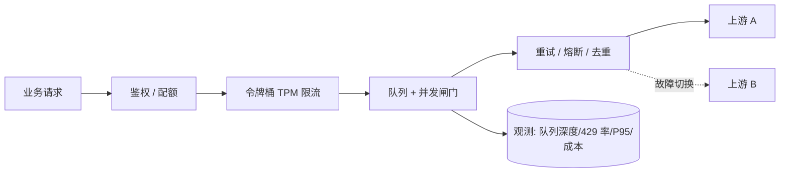

把 LLM API 调用的并发做稳，难点不在"写一个队列"，而在于几个机制之间会互相拆台：重试把限流打穿、排队把超时拖长、超时又触发更多重试，最后队列越堆越高。这篇按请求的生命周期走一遍，重点说明这些机制怎么配合。

## 一、限额不是一个数

厂商标称的限制至少有三个维度，很多实现只防住了第一个：

| 维度 | 典型形态 | 超限表现 |
|---|---|---|
| 请求速率 | RPM / RPD（每分钟、每天请求数） | 429 |
| Token 速率 | TPM（每分钟 Token 数） | 429，且长输入更容易撞 |
| 并发 | 同时在途的请求数 | 429 或排队 |

开发文档给出的并发上限是**示例值**，与账号、套餐、模型和服务条件相关。例如某厂商在价格页并列两个模型时给出 2500 与 500 两个不同的并发数（2026-10-31 核验），这已经说明"限额是模型相关的"，何况它还随账号等级变化。所以不要把文档里的数字直接当常量写进配置——放到配置项里，并留出可通过环境变量覆盖的入口。

实践里最容易忽略的是 TPM：一个 200K Token 的长文档请求，在 RPM 上只算 1 次，在 TPM 上却等于几百次普通请求。如果只按请求数限流，长请求会在瞬间把 TPM 打满。容量规划时要把各模型的上下文上限与单价一起看——同样的 TPM 额度，放在长上下文模型上能承载的请求数完全不同，规格与核验日期见 [模型库](/models/)。

## 二、三个时间尺度：速率、并发、排队

这三个量经常被混用，但它们回答不同的问题：

- **速率**回答"我每秒可以发起多少"；
- **并发**回答"同一时刻允许有多少个在途"；
- **排队**回答"超出的部分放哪里、愿意等多久"。

LLM 调用的延迟分布很长（首 Token 几百毫秒到几秒，完整响应可能几十秒），所以**只限速率是不够的**：即便 RPM 达标，只要上游变慢，在途请求数会自然膨胀，连接、内存、超时都会跟着恶化。并发闸门在这里的作用比速率限制更大。

## 三、限流算法：固定窗口的那个坑

Redis 官方文档给了两个经典的固定窗口实现，其中一个坑值得每个人知道：按 `ip:秒` 分键计数时，窗口是对齐自然秒的，于是**在 59.9 秒放行 10 次、60.1 秒再放行 10 次**，一秒内实际通过了 20 次——边界处的双倍突发。

另一个坑是 `INCR` 与 `EXPIRE` 不是原子的：如果 `INCR` 成功而 `EXPIRE` 没执行（进程崩溃、连接中断），这个键就永远不会归零，该用户的额度被永久锁死。官方给的两个修法是把两条命令放进 `MULTI/EXEC`，或用 Lua 脚本合并（脚本里先 `incr`，返回值为 1 时再 `expire`）。

由此得到一个选择原则：

| 场景 | 合适算法 | 理由 |
|---|---|---|
| 防刷、粗粒度配额 | 固定窗口计数 | 实现最简单，边界突发可接受 |
| 需要平滑放行、保护下游 | 令牌桶 | 允许一定突发，长期速率可控 |
| 严格匀速、不允许突发 | 漏桶 | 出队速率恒定，代价是延迟 |
| 按用户维度的精确配额 | 滑动窗口（有序集合） | 无边界突发，内存成本更高 |

令牌桶要在"补充令牌"和"扣减令牌"之间保证原子性，多实例部署时同样得用 Redis + Lua 实现，不能各进程各算一份。

## 四、整体架构

<figure style="margin:18px 0">
  <svg viewBox="0 0 700 300" role="img" aria-label="高并发 LLM 调用架构：入口鉴权、令牌桶限流、并发闸门、重试与熔断、上游供应商" style="width:100%;height:auto">
    <defs>
      <marker id="hcArrow" viewBox="0 0 10 10" refX="9" refY="5" markerWidth="6" markerHeight="6" orient="auto-start-reverse">
        <path d="M 0 0 L 10 5 L 0 10 z" fill="#8A93A5"></path>
      </marker>
    </defs>
    <rect x="10" y="30" width="120" height="44" rx="8" fill="#F1F4F9" stroke="#C9D2E0"></rect>
    <text x="70" y="57" text-anchor="middle" font-size="13" fill="#2A3242">业务请求</text>
    <line x1="134" y1="52" x2="156" y2="52" stroke="#8A93A5" stroke-width="1.5" marker-end="url(#hcArrow)"></line>
    <rect x="160" y="30" width="120" height="44" rx="8" fill="#F1F4F9" stroke="#C9D2E0"></rect>
    <text x="220" y="57" text-anchor="middle" font-size="13" fill="#2A3242">鉴权 / 配额</text>
    <line x1="284" y1="52" x2="306" y2="52" stroke="#8A93A5" stroke-width="1.5" marker-end="url(#hcArrow)"></line>
    <rect x="310" y="30" width="120" height="44" rx="8" fill="#F1F4F9" stroke="#C9D2E0"></rect>
    <text x="370" y="57" text-anchor="middle" font-size="13" fill="#2A3242">令牌桶 / TPM</text>
    <line x1="434" y1="52" x2="456" y2="52" stroke="#8A93A5" stroke-width="1.5" marker-end="url(#hcArrow)"></line>
    <rect x="460" y="30" width="120" height="44" rx="8" fill="#EDF1F8" stroke="#C9D2E0"></rect>
    <text x="520" y="57" text-anchor="middle" font-size="13" fill="#2A3242">队列 / 并发闸门</text>
    <line x1="520" y1="78" x2="520" y2="104" stroke="#8A93A5" stroke-width="1.5" marker-end="url(#hcArrow)"></line>
    <rect x="420" y="108" width="200" height="44" rx="8" fill="#F1F4F9" stroke="#C9D2E0"></rect>
    <text x="520" y="135" text-anchor="middle" font-size="13" fill="#2A3242">重试 / 熔断 / 去重</text>
    <line x1="420" y1="130" x2="300" y2="130" stroke="#8A93A5" stroke-width="1.5" marker-end="url(#hcArrow)"></line>
    <rect x="120" y="108" width="176" height="44" rx="8" fill="#F1F4F9" stroke="#C9D2E0"></rect>
    <text x="208" y="135" text-anchor="middle" font-size="13" fill="#2A3242">上游供应商 A</text>
    <line x1="300" y1="152" x2="300" y2="178" stroke="#8A93A5" stroke-width="1.5" marker-end="url(#hcArrow)"></line>
    <rect x="120" y="182" width="176" height="44" rx="8" fill="#F1F4F9" stroke="#C9D2E0"></rect>
    <text x="208" y="209" text-anchor="middle" font-size="13" fill="#2A3242">上游供应商 B（切换）</text>
    <rect x="10" y="240" width="680" height="44" rx="8" fill="#EDF1F8" stroke="#C9D2E0"></rect>
    <text x="350" y="267" text-anchor="middle" font-size="13" fill="#2A3242">观测：队列深度、等待时长、429 率、重试率、P95 延迟、取消率、单请求成本</text>
  </svg>
  <figcaption style="font-size:12px;color:#8A93A5;margin-top:6px">每一层都可能成为瓶颈；缺任何一层的观测，排障都会变成猜。</figcaption>
</figure>

同一套结构的 Mermaid 源码（本站正文未接入 Mermaid 渲染器，粘贴到支持 Mermaid 的编辑器即可出图）：



## 五、并发闸门比速率限制更要紧

一个简单的闸门实现只需十几行。注意释放时"把名额直接转交"的写法——先唤醒等待者、再决定是否减计数，可以避免唤醒瞬间被新请求抢占名额：

```ts
/** 限制在途请求数；适合包住每一个上游调用 */
export class Semaphore {
  private active = 0;
  private readonly waiters: Array<() => void> = [];

  constructor(private readonly limit: number) {
    if (limit < 1) throw new Error('limit 必须 >= 1');
  }

  async acquire(): Promise<void> {
    if (this.active < this.limit) { this.active++; return; }
    await new Promise<void>(resolve => this.waiters.push(resolve)); // 名额由 release 转交
  }

  release(): void {
    const next = this.waiters.shift();
    if (next) next();
    else this.active--;
  }

  get inflight(): number { return this.active; }
}
```

令牌桶则负责"每秒能发多少"，并且要能按 Token 数扣费（长请求扣得多）：

```ts
export class TokenBucket {
  private tokens: number;
  private lastRefill = Date.now();

  constructor(private readonly capacity: number, private readonly refillPerSec: number) {
    this.tokens = capacity;
  }

  /** 取 n 个令牌；不足时等待。返回累计等待毫秒数，便于判定"是不是在排队" */
  async take(n = 1): Promise<number> {
    /* 单次请求要的令牌数不能超过桶容量：桶里最多只有 capacity 个，
       否则条件永远不会满足，这里会变成死循环（不是"等得久"，是永远等不到）。
       容量必须按"单次最大请求"来设，见下方说明。 */
    if (n > this.capacity) {
      throw new RangeError(`take(${n}) 超过桶容量 ${this.capacity}：请把容量设为单次最大请求的令牌数`);
    }
    let waited = 0;
    for (;;) {
      this.refill();
      if (this.tokens >= n) { this.tokens -= n; return waited; }
      const waitMs = Math.max(1, Math.ceil(((n - this.tokens) / this.refillPerSec) * 1000));
      await new Promise<void>(r => setTimeout(r, waitMs));
      waited += waitMs;
    }
  }

  private refill(): void {
    const now = Date.now();
    const gained = ((now - this.lastRefill) / 1000) * this.refillPerSec;
    if (gained <= 0) return;
    this.tokens = Math.min(this.capacity, this.tokens + gained);
    this.lastRefill = now;
  }
}
```

桶容量这个参数容易被随手设成"每分钟额度"，然后遇到一个超长请求就卡死。正确的口径是：`capacity` 至少等于**单次请求最大可能消耗的令牌数**（比如最长的输入 + 预留输出），补充速率才对应长期均值。

`take()` 返回值不是装饰：把它记进指标，就能区分"上游慢导致排队"和"自己限得太紧导致排队"——前者要扩上游或多供应商，后者要调容量。

## 六、重试：要设预算，不只是设次数

重试必须同时满足三个条件，否则它会把故障放大：

1. **只重试可重试的错误**：429、5xx、超时、连接失败。400/401/403/422 重试毫无意义，只会把错误重复三遍并多付输入费。
2. **尊重 `Retry-After`**：429 与 503 都可能带这个头，明确告诉你多久之后再来；官方语义就是让你按它等待（429 也支持 HTTP-date 形式）。自己拍的指数退避通常比它更短，于是继续撞墙。
3. **有预算上限**：单次调用的重试次数、以及全局的"重试占总请求比例"。后者更关键——当 429 率高到一定程度，重试只会让情况更糟，此时应该降级而不是继续加码。

```ts
export interface RetryOptions {
  maxAttempts?: number;
  isRetryable: (err: unknown) => boolean;
  baseMs?: number;
  capMs?: number;
  /** 单个请求从首次发出到放弃的总时长预算 */
  budgetMs?: number;
}

export async function withRetry<T>(fn: (attempt: number) => Promise<T>, opts: RetryOptions): Promise<T> {
  const { maxAttempts = 3, isRetryable, baseMs = 400, capMs = 8_000, budgetMs = 60_000 } = opts;
  const started = Date.now();
  let lastError: unknown;

  for (let attempt = 1; attempt <= maxAttempts; attempt++) {
    try {
      return await fn(attempt);
    } catch (err) {
      lastError = err;
      if (attempt === maxAttempts || !isRetryable(err)) throw err;
      const ceiling = Math.min(capMs, baseMs * 2 ** (attempt - 1));
      const wait = Math.floor(Math.random() * ceiling); // full jitter，避免同步重试
      if (Date.now() - started + wait > budgetMs) throw err;
      await new Promise<void>(r => setTimeout(r, wait));
    }
  }
  throw lastError;
}
```

满抖动（`Math.random() * ceiling`）而不是"指数 + 固定抖动"，是因为后者仍会让一批同时失败的请求在相近时刻重试；满抖动把重试时间摊平到整个区间。

## 七、超时、取消与"钱白花"

三层超时是必须的：连接/首字节、流式空闲、总时长。第二层只能自己实现（收到数据就重置计时器）。

更重要的是**取消要向上游传播**。用户关掉页面后，如果服务端不 abort 上游请求，模型会继续生成到 `max_tokens`——你为一段没人看的内容付全价。Node 里的写法是把客户端断开信号与超时信号合并：

```ts
export function requestSignal(disconnect: AbortSignal, timeoutMs: number): AbortSignal {
  // AbortSignal.any：任一信号中止即中止（Node 18.17+ / 20+ 可用）
  return AbortSignal.any([disconnect, AbortSignal.timeout(timeoutMs)]);
}
```

取消率本身是个重要指标：取消率高说明前端超时设置太短，或者用户已经放弃等待——两种情况都该改配置，而不是怪模型慢。

## 八、幂等与去重：省的是钱，不是请求

高并发下重复请求的来源不止用户点击：客户端超时重试、网关重放、消息队列 at-least-once 投递，都会让同一次业务意图被发送多次。

`Idempotency-Key` 这个头部草案（draft-08）定义的语义值得直接借用：同一个键配不同请求体，服务端应返回 422 表示"键已被用于另一个请求"；同一键的并发重复请求返回 409；原请求已完成的重试则重放原结果。这套语义用在 LLM 调用上同样成立，而且很实用——**同一个键只允许真正调用一次上游，重复请求直接复用第一次的结果**。

在业务侧还有一个更廉价的近似做法：对 Prompt 做规范化（去掉时间戳、排序工具定义、统一空白）后取哈希，短时间窗口内同哈希的请求直接复用结果。这对"用户连点发送"和"同一个批处理任务被重复调度"两类场景足够有效，成本是零次上游调用。

## 九、熔断与多供应商

熔断的判定不该只看错误率，还要看**错误类型分布**：429 高说明自己发太快，5xx 高说明上游有问题，超时高可能是网络或模型排队。三者的处置完全不同——前者降速，中者切换，后者扩容量。

多供应商切换的工程前提是抽象好调用层：请求体、响应解析、错误分类都要能适配不同厂商，否则"切换"只是把故障从一家搬到另一家。切换还要有回切策略（冷却期 + 探测请求），否则会在两个供应商之间来回抖动。

## 十、流式响应的连接管理

流式把长连接变成了常态，两个问题随之出现：

**背压。** 消费者慢（客户端网络差、下游处理慢）时，服务端缓冲区会堆积。要在缓冲区高水位时暂停读取上游，而不是无限缓存——一个卡住的客户端足以吃光进程内存。

**连接数与超时。** 流式连接的生命周期比普通请求长一个数量级，并发闸门要按"连接数"而不是"请求数"设。空闲超时也要设，否则半开连接会一直挂着。

## 十一、该盯哪些指标

- **队列**：深度、等待时长 P95（等待时长涨 = 容量不足或上游变慢）；
- **限流**：429 率、限流命中分布（按用户/接口/模型）；
- **重试**：重试率、重试成功占比（重试几乎不成功说明问题不在瞬时抖动）；
- **上游**：首 Token 延迟 P95、完整响应延迟 P95、按状态码分布；
- **取消**：客户端取消率、上游 abort 成功率；
- **钱**：单请求平均成本、每千次请求成本、超额用户数。

这六组指标里，最容易被漏掉的是"等待时长"和"取消率"——它们不体现在错误率上，但直接决定用户体验和你为无效生成付了多少钱。

## 十二、与相邻话题的分工

请求侧的细节（请求结构、超时分层、错误分诊、流式解析、usage 记账）属于接入指南的话题；密钥、鉴权与配额归属属于安全实践的话题——这两篇目前都在草稿阶段，发布后会在本节补上站内链接。本文只处理"多个请求同时来的时候系统怎么不崩"。

一个可以直接落地的顺序：先把并发闸门和三层超时加上（半小时的工作量，能挡掉大部分雪崩），再把重试改成"可重试分类 + 尊重 Retry-After + 抖退避"，最后补指标。顺序反过来的话，你会在没有数据的情况下调参数，那是另一种形式的猜。

<!-- 待 llm-api-integration 与 llm-api-security 发布后，在第十二节补站内链接（当前均为草稿，发布前不得互链）。 -->
